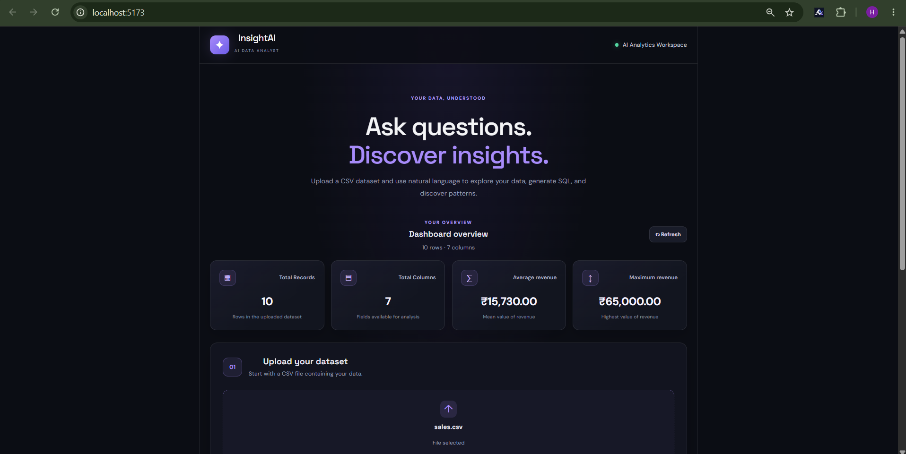
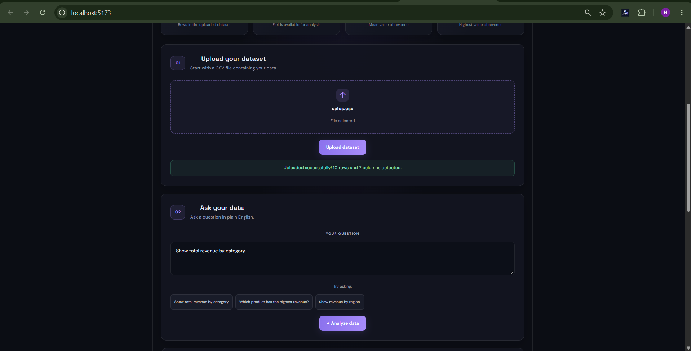
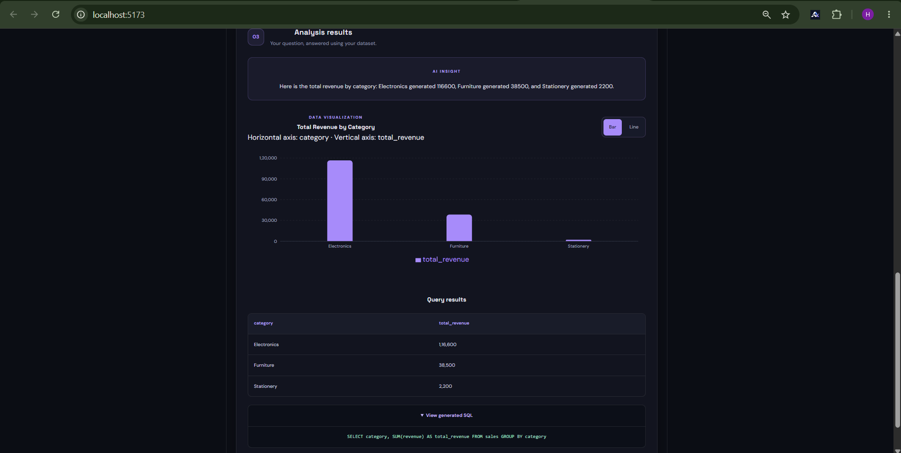
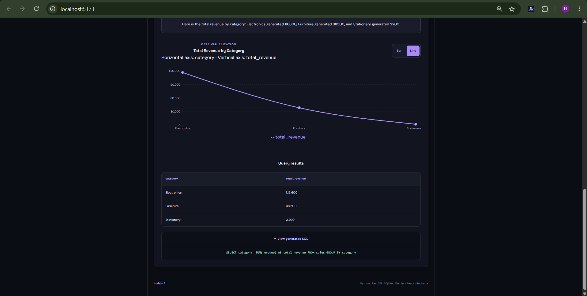
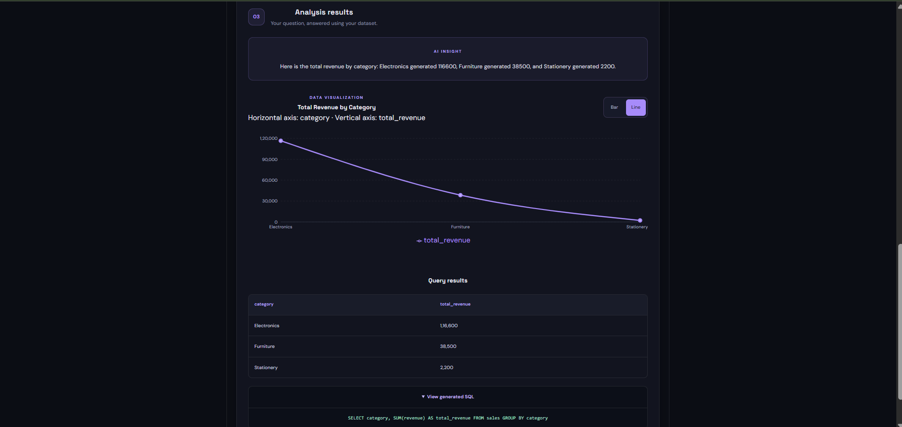
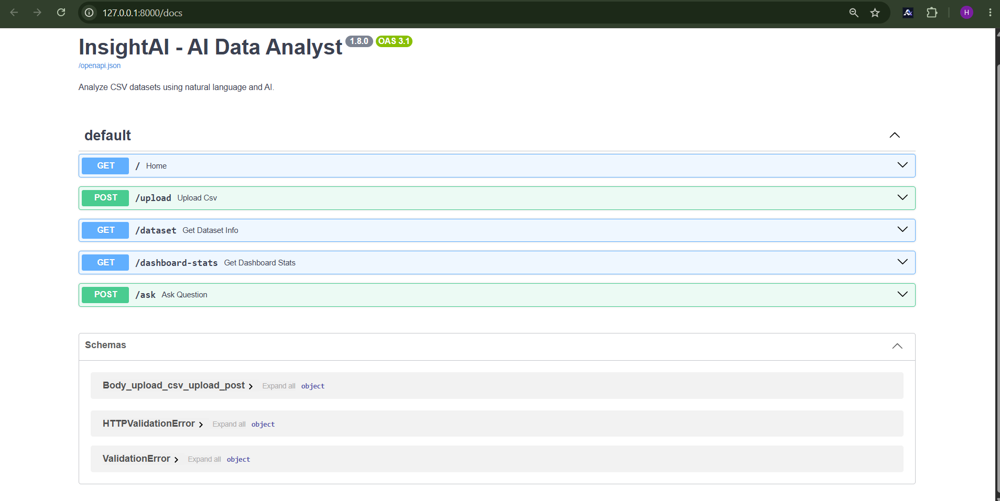

## 📸 Project Screenshots

### Home Page



### Data Analysis & Question Answering



### Bar Chart



### Homepage Bottom



### Line Chart



### Swagger API Documentation



# InsightAI — AI Data Analyst

InsightAI is an AI-powered data analysis web application that helps users explore CSV datasets, view key statistics, ask questions about their data, and visualize results through interactive charts.

## Features

* **CSV Upload:** Upload datasets and analyze their contents.
* **Interactive Dashboard:** View key performance indicators (KPIs), including total records, columns, averages, and maximum values.
* **AI-Powered Insights:** Generate natural-language answers to questions about uploaded data using Google Gemini.
* **SQL Query Generation:** Convert natural-language questions into SQL queries for data analysis.
* **Data Visualization:** Explore query results using bar and line charts.
* **Query Results Table:** View the records returned by generated queries.
* **Dataset Statistics:** Calculate numerical and categorical statistics.
* **Safe Question Handling:** Detect requests for unsupported fields and explain which columns are available.
* **Multiple Dataset Support:** Test the application with different CSV files.

## Tech Stack

**Frontend**

* React
* Vite
* Recharts
* JavaScript
* CSS

**Backend**

* Python
* FastAPI
* Pandas
* SQLite
* Google Gemini API

## Project Structure

```text
AI-Data-Analyst/
├── backend/
│   ├── main.py
│   ├── .env
│   └── sales.db
├── data/
│   ├── sales.csv
│   ├── students.csv
│   └── test_missing.csv
├── frontend/
│   ├── src/
│   ├── public/
│   ├── package.json
│   └── vite.config.js
├── README.md
├── requirements.txt
├── .gitignore
└── start_project.bat
```

## Getting Started

### Prerequisites

Install the following before running the project:

* Python
* Node.js and npm
* A Google Gemini API key for AI-powered analysis

### 1. Clone the repository

```bash
git clone <your-github-repository-url>
cd AI-Data-Analyst
```

### 2. Install backend dependencies

Open a terminal in the project root:

```bash
python -m venv backend/venv
```

Activate the virtual environment on Windows:

```powershell
.\backend\venv\Scripts\Activate.ps1
```

Install the required packages:

```bash
pip install -r requirements.txt
```

### 3. Configure the Gemini API key

Create a `.env` file inside the `backend` directory:

```text
GEMINI_API_KEY=your_gemini_api_key
```

Replace the placeholder with your own API key. Never commit the `.env` file to GitHub.

### 4. Install frontend dependencies

```bash
cd frontend
npm install
cd ..
```

### 5. Run the application

On Windows, run:

```text
start_project.bat
```

This starts the backend and frontend using the project's configured startup script.

Open the frontend at:

http://localhost:5173/

The FastAPI documentation is available at:

http://127.0.0.1:8000/docs

## Sample Datasets

The `data/` directory contains sample CSV files for testing:

* `sales.csv` — product sales, revenue, quantity, and region.
* `students.csv` — student subjects and marks.
* `test_missing.csv` — a sample dataset containing missing values.

Upload a dataset through the application to explore its statistics and test data-analysis questions.

## Example Questions

Try asking InsightAI questions such as:

* Show total revenue by region.
* Which product generated the highest revenue?
* Show revenue by product.
* Calculate the average marks.

The results depend on the dataset currently uploaded.

## Error Handling

InsightAI includes handling for unsupported fields and unavailable dataset information. AI-generated answers depend on Gemini API availability and quota limits.

## Future Improvements

* Support additional chart types.
* Improve analysis of missing values and unusual data.
* Add export options for query results and charts.
* Improve persistence of previous analysis sessions.
* Add more advanced data-analysis capabilities.

## Author

**Harini S**

B.Tech — Artificial Intelligence and Data Science

## License

This project is intended for educational, portfolio, and demonstration purposes. Add a license file if you choose to distribute it under a specific open-source license.


